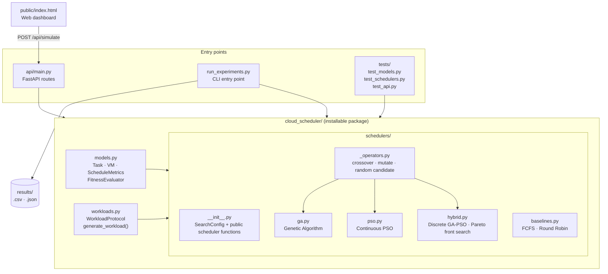

# PT171-Meta_heuristic_algorithm_for_task_scheduling_in_cloud_infrastructure

## Live demo

[Open the deployed Cloud Task Scheduler](https://cloud-task-scheduler.vercel.app/)


## Architecture

The `cloud_scheduler` package holds all the scheduling logic. The CLI, the FastAPI backend and the tests are thin layers on top of it.

### File structure

```text
meta-heuristic-algorithm-for-task-scheduling-in-cloud-infrastructure/
├── api/
│   └── main.py              # FastAPI routes (delegates to core package)
├── cloud_scheduler/
│   ├── __init__.py          # Top-level API exports
│   ├── models.py            # Task, VM, ScheduleMetrics, FitnessEvaluator
│   ├── workloads.py         # WorkloadProtocol + generate_workload()
│   └── schedulers/
│       ├── __init__.py      # Exports SearchConfig & public scheduler functions
│       ├── _operators.py    # Shared GA/PSO operators (crossover, mutate, random candidate)
│       ├── baselines.py     # FCFS and Round Robin
│       ├── ga.py            # Genetic Algorithm
│       ├── pso.py           # Continuous PSO
│       └── hybrid.py        # Discrete GA-PSO and Pareto front search
├── tests/
│   ├── test_models.py       # Metrics, energy bounds, validation
│   ├── test_schedulers.py   # Determinism, convergence, invariants for all 5 algorithms
│   └── test_api.py          # API endpoint and simulation integration tests
├── public/
│   └── index.html           # Frontend web dashboard
├── results/                 # Experiment outputs (.csv, .json)
├── run_experiments.py       # CLI entry point
├── pyproject.toml           # Packaging (pip install -e .)
├── requirements.txt         # Runtime dependencies
├── render.yaml              # Render deployment config
├── vercel.json              # Vercel deployment config
└── README.md
```

### Architecture


