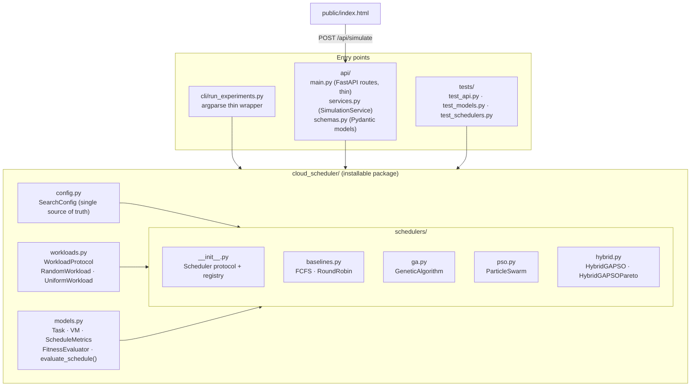

# PT171-Meta_heuristic_algorithm_for_task_scheduling_in_cloud_infrastructure

## Live demo

[Open the deployed Cloud Task Scheduler](https://cloud-task-scheduler.vercel.app/)

## Architecture

The diagram below shows the target architecture. The `cloud_scheduler` package holds all the logic, and the CLI, API and tests are thin layers on top of it.

